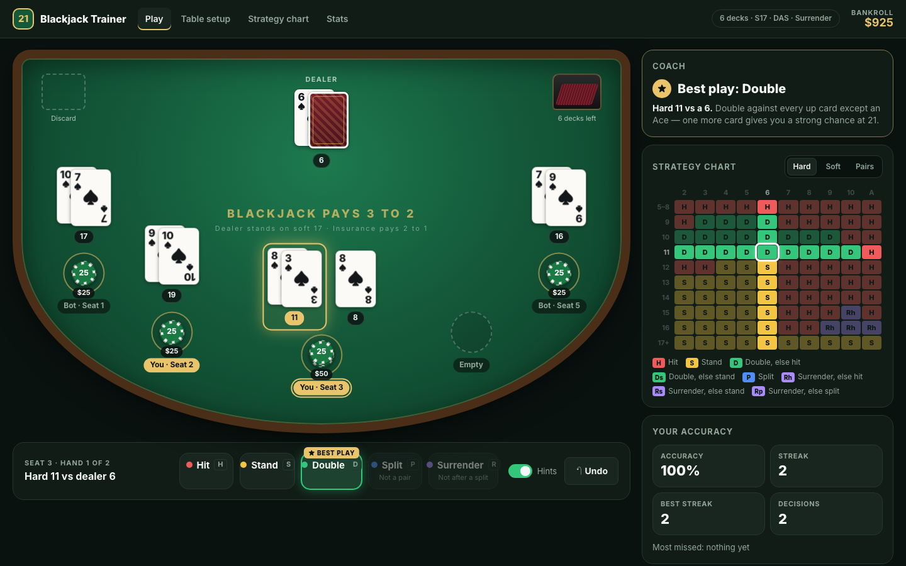

# Blackjack Trainer

Practice blackjack basic strategy at a 5-seat table with a live coach that shows the best play.

**Live app:** https://viczuno.github.io/blackjack-trainer/



Blackjack Trainer is a static web app for learning basic strategy. You play at a table with up to five seats, can run several hands at once (several seats and splits), and the coach highlights the best button, marks the cell in a strategy chart and explains the move in plain words. It runs in the browser, installs on a phone as a PWA, works offline and needs no account or backend.

## Features

- **5-seat table**: each seat is empty, yours or a bot. Bots play perfect basic strategy. Play order is Seat 1 → Seat 5, then split hands in order.
- **Full rules**: splits up to 4 hands per seat, split aces (one card each, optional re-split), double on any two cards, double after split, late surrender, insurance, US-style dealer peek, reshuffle at 75% of the shoe.
- **Coach** with three modes:
  - _Always_: the best button gets a "★ BEST PLAY" tag, the chart cell is highlighted and the coach explains why.
  - _Only after a mistake_: a toast says what the best play was, with Undo.
  - _Test mode_: no hints and no undo; mistakes are reviewed when the shoe ends.
- **Strategy chart** for hard, soft and pairs that changes with the rules (S17/H17, DAS, surrender), with a crosshair on the current hand.
- **Stats**: accuracy, streaks, accuracy over time, most-missed hands with **Drill it**, which deals that exact situation 10 times.
- **Practice focus**: get only hard totals, soft totals or pairs.
- **Keyboard**: `H` Hit, `S` Stand, `D` Double, `P` Split, `R` Surrender, `U` Undo, `Space` Deal / Next round, `I` / `N` insurance.
- **Mobile**: seat strip, large action buttons, bottom sheet with the coach and chart; add it to your home screen for full-screen, offline play.
- Settings, bankroll and stats are saved in `localStorage` on your device. "Reset bankroll" returns to $1,000.

## Rules and strategy

| Rule                     | Options                   | Default |
| ------------------------ | ------------------------- | ------- |
| Decks                    | 4, 6, 8                   | 6       |
| Dealer soft 17           | Stands (S17) / Hits (H17) | S17     |
| Double after split       | on / off                  | on      |
| Late surrender           | on / off                  | on      |
| Re-split aces            | on / off                  | off     |
| Max hands from splitting | 2, 3, 4                   | 4       |

Fixed: blackjack pays 3:2, insurance pays 2:1, the dealer peeks with an A or 10 up, and the shoe is reshuffled at the cut card (75%).

The charts are the standard multi-deck (4–8 decks) basic strategy with the usual H17 changes (11 vs A double, 15 vs A and 17 vs A surrender, A,7 vs 2 and A,8 vs 6 double, 8,8 vs A surrender). They live as data in [`src/strategy/tables.ts`](src/strategy/tables.ts), and every one of the 280 cells is tested for S17 and H17. When a play is not allowed (no surrender, no double after three cards, no DAS, max splits), the chart code falls back: `Rh→H`, `Rs→S`, `Rp→P`, `D→H`, `Ds→S`, `Ph→H`. Insurance is never taken.

## Tech stack

TypeScript (strict), React, Vite, Zustand, Framer Motion and CSS Modules with design tokens. Vitest for the engine and strategy, Playwright for smoke tests, `vite-plugin-pwa` for the offline PWA. Deployed to GitHub Pages with GitHub Actions.

## Getting started

### Prerequisites

- Node.js 22 or newer

### Install and run

```bash
git clone https://github.com/viczuno/blackjack-trainer.git
cd blackjack-trainer
npm install
npm run dev
```

Open http://localhost:5173/blackjack-trainer/. In dev builds, `window.__bj.stack('8 6 8 10 …')` puts cards on top of the shoe for manual testing (deal order: one card per occupied seat, the dealer's up card, the second cards, then the hole card).

## Testing

```bash
npm test               # Vitest: all 280 chart cells (S17 + H17), engine, settlement, stats, 100-round simulations
npm run coverage       # coverage for src/engine and src/strategy
npm run lint           # oxlint + Prettier check
npx playwright install chromium
npm run e2e            # Playwright smoke tests on desktop and mobile viewports
```

## Project structure

```
.github/workflows/  CI: lint, test, build, deploy to GitHub Pages
docs/               README screenshot
public/             favicon and PWA icons
scripts/            make-icons.mjs renders the PWA icons
src/engine/         pure TypeScript game engine: cards, shoe, seeded RNG, reducer, dealer, settlement, bots, drills
src/strategy/       chart data, lookup, fallbacks and plain-language explanations
src/stats/          decision and round statistics
src/store/          Zustand stores for the game (timing, undo, persistence) and settings
src/ui/             tokens, components and screens (table, setup, chart, stats)
tests/              Vitest unit tests and Playwright e2e tests
```

## Deploy

Every push to `main` runs lint, tests and the build, then deploys `dist/` to GitHub Pages (Settings → Pages → Source: GitHub Actions). `base` in `vite.config.ts` must match the repository name. Routing uses the URL hash (`#/setup`, `#/chart`, `#/stats`) so refreshes never 404.

On an iPhone, open the live URL in Safari → Share → **Add to Home Screen**.

## Contributing

Changes go through pull requests using Conventional Commits
(`feat:`, `fix:`, `docs:` …).

## License

MIT. See [LICENSE](LICENSE).
